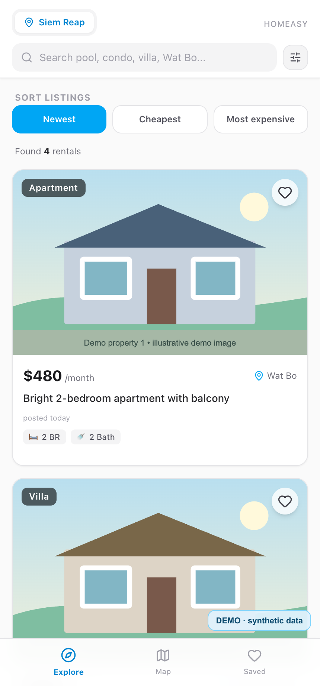

# Homeasy — демонстрация проекта

**English overview.** Homeasy is a working rental-search prototype for Cambodia. It collects and normalizes listings, checks duplicates, and connects an API, Telegram bot and mini app. This repository contains selected real source excerpts and a separate interactive demo with fictional data. The demo is not a benchmark of the live parser.

- [Case study in English](https://portfolio.rustycat.cc/en/homeasy.html)
- [Interactive demo in English](https://portfolio.rustycat.cc/en/demo-homeasy/index.html)
- [Кейс на русском](https://portfolio.rustycat.cc/homeasy.html) · [демо на русском](https://portfolio.rustycat.cc/demo-homeasy/index.html)

Homeasy — разрабатываемый агрегатор объявлений об аренде жилья в Камбодже. Рабочий проект объединяет сбор данных из нескольких источников, обработку текстов, поиск повторов, API, Telegram-бота и мини-приложение.

**Интерактивный пример:** скачайте репозиторий и откройте файл `demo/index.html` в браузере. Три вымышленные публикации превращаются в две карточки после нормализации и удаления повтора. Результат можно фильтровать по городу. Пример работает без сервера и доступа к сети: настоящие парсеры, языковая модель, Telegram, рабочие API и пользовательские данные в нём не используются.

*Снимок интерфейса основного мини-приложения на специально подготовленных вымышленных данных.*

## Что здесь есть

- `demo/` — самостоятельная интерактивная модель обработки объявлений, открывается через `demo/index.html`.
- `screenshots/` — три кадра настоящего интерфейса мини-приложения Telegram на специально подготовленных вымышленных данных.
- `source-excerpts/` — выбранные файлы **из реализации рабочего проекта**: схема данных, обнаружение спама, вычисление визуальных отпечатков и логика сопоставления повторов. Это *иллюстрации архитектурных решений*, они зависят от модулей рабочего продукта и не составляют самостоятельную сборку.

## Мой вклад

Идея и требования, разделение на модули, схема обработки объявлений, технические решения, разработка с использованием ИИ, проверка и доработка по результатам тестирования.

## Устройство основного проекта

Публикации из разных источников → извлечение и проверка полей → нормализация → сопоставление повторов → хранение и выдача через API → Telegram-бот и мини-приложение. Внутри этапов используются отдельные модули, что позволяет проверять качество извлечения и поиска повторов независимо от пользовательского интерфейса.

В файле [`deduplicator.ts`](source-excerpts/src/modules/matcher/deduplicator.ts) показана многофакторная оценка сходства записей: изображения, цена, характеристики жилья и контактные признаки. Это рабочий исходный код, выбранный для изучения решений; его зависимости и данные намеренно не включены в этот репозиторий. Пример в `demo/` реализован отдельно и использует более простые правила.

## Границы демоверсии

Это отдельный публичный материал, а не копия работающего сервиса: исходный проект постоянно развивается и содержит закрытые интеграции и пользовательские данные. Для демонстрации перенесены только файлы из проверенного списка. Git-история рабочего репозитория не копировалась.

Для локального просмотра сборка, установка пакетов и доступ к интернету не требуются. Браузерная версия доступна на [русском](https://portfolio.rustycat.cc/demo-homeasy/index.html) и [английском](https://portfolio.rustycat.cc/en/demo-homeasy/index.html).
